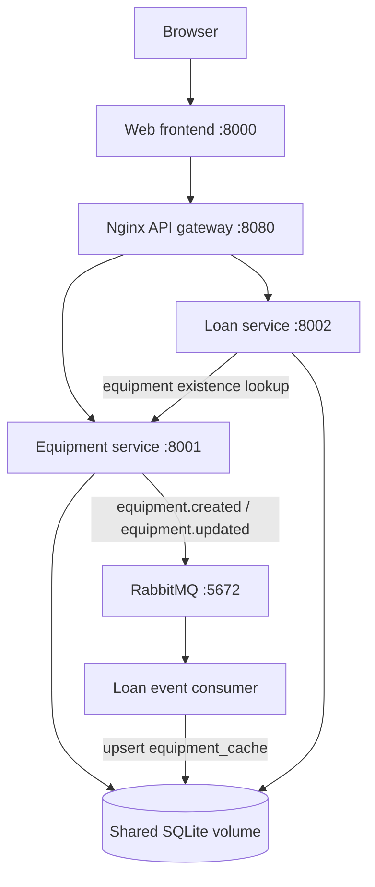
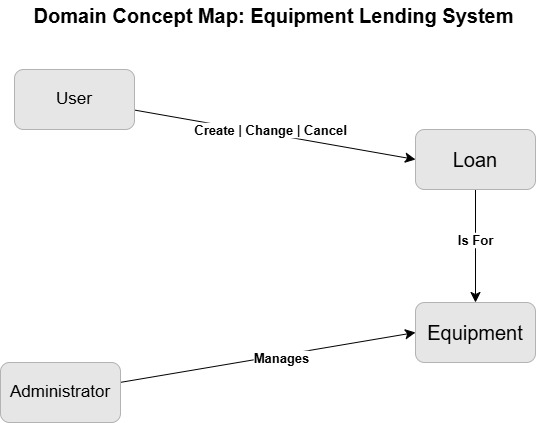

# Equipment Lending System

A containerized equipment lending application built with **FastAPI**, **Nginx**, **RabbitMQ**, and **SQLite**. The project is structured for the university Continuous Integration assignment and its Checkpoint 5 microservices architecture.

Users manage equipment and date-based loans through a browser. A separate web frontend calls two backend services through one Nginx API gateway. The backend services share a SQLite database for this classroom deployment, while RabbitMQ delivers equipment-change events to a separate loan-side consumer.

## Architecture



| Component | Implementation | Responsibility |
| --- | --- | --- |
| Web frontend | `web/main.py` | Dashboard, HTML forms, equipment and loan views, availability search |
| API gateway | `gateway/nginx.conf` | Routes `/equipment` to Equipment Service and `/loans` to Loan Service |
| Equipment Service | `services/equipment_service/` | List, retrieve, create, and update equipment; publish change events |
| Loan Service | `services/loan_service/` | Create, list, change, and cancel loans; reject overlapping bookings |
| RabbitMQ | `rabbitmq:4-management` | Topic exchange for equipment events |
| Loan consumer | `messaging/consumer.py` | Consumes events and updates the `equipment_cache` table |
| Shared database | Docker volume `shared_data` | Stores equipment, loans, deletion guards, and cache in `/data/lending_shared.db` |

Docker Compose starts **six containers**: `web`, `gateway`, `equipment`, `loan`, `rabbitmq`, and `loan_consumer`. RabbitMQ also has its own persistent `rabbitmq_data` volume.

> **Deployment scope:** Sharing a SQLite file across containers on a single Docker host is a classroom-oriented arrangement, not a production multi-host database architecture. The web frontend has no direct SQLite access; its calls go through the gateway. The Loan Service also makes an internal equipment lookup directly to the Equipment Service.

## Domain Concept Map

The following diagram illustrates the relationships between the main actors and business concepts in the Equipment Lending System.




**Concept meanings:** A **User** creates, changes, or cancels a **Loan**. Each **Loan** is for one **Equipment** item. An **Administrator** manages the equipment catalog. The conceptual roles express the intended domain; the current application does not implement authentication or role-based authorization for `User` and `Administrator`.

This map complements the **DDD context map** above: equipment management belongs to the Equipment Catalog context, while loan management belongs to the Loan Management context. Neither diagram is intended as a physical database schema.

**Key business rules:**

- An equipment item may be referenced by many loans over time, but **two active loans for the same equipment cannot overlap**, including on their boundary dates.
- A loan's start date must be on or before its end date; dates use ISO `YYYY-MM-DD` format.
- A loan can be **active** or **cancelled**. A cancelled loan does not block availability and cannot be changed.
- Equipment is modeled with **active** and **deleted** lifecycle statuses, but the deletion operation is **not yet enabled** in the web application.
- The equipment ID in a Loan is a cross-context reference. The current shared database implementation does not enforce this link with a SQL foreign key; the Loan Service checks existence through the Equipment API.

### Supporting technical data models

These are infrastructure/read-model concepts, not additional business aggregates:

| Model | Purpose | Owned/updated by |
| --- | --- | --- |
| `equipment_cache` | Stores the latest consumed equipment name, description, and status | RabbitMQ loan consumer |
| `equipment_deletion_guards` | Records pending/deleted states for an unfinished coordinated deletion workflow | Loan Service's deletion guard logic |

The Equipment Service is the source of truth for equipment records. Because event publishing is not transactional with database commits, `equipment_cache` can temporarily or permanently lag behind the source if publication fails; use it as a demonstration of asynchronous synchronization, not as a guaranteed consistent source of truth.

## Prerequisites

- Docker Desktop (Linux containers) with Docker Compose
- For local development/tests: Python 3.13 (the GitLab runner uses `py -3.13`), `pip`, and a virtual environment
- Git, for cloning and pushing changes

## Quick start with Docker

From the project root:

```bash
docker compose config --quiet
docker compose up -d --build
docker compose ps
```

Visit:

| URL | Purpose |
| --- | --- |
| http://localhost:8000 | Web frontend |
| http://localhost:8000/ui/equipment | Equipment management |
| http://localhost:8000/ui/loans | Loan management |
| http://localhost:8000/ui/availability | Equipment availability search |
| http://localhost:8080/health | Nginx gateway health |
| http://localhost:8080/equipment | Equipment API through the gateway |
| http://localhost:8080/loans | Loan API through the gateway |
| http://localhost:8001/docs | Equipment Service Swagger/OpenAPI UI (development port) |
| http://localhost:8002/docs | Loan Service Swagger/OpenAPI UI (development port) |
| http://localhost:15672 | RabbitMQ management dashboard |

RabbitMQ's **development-only** username and password are configured in `compose.yaml`. Change the example credentials and their corresponding connection URLs before exposing the application outside your local machine. The current Compose configuration publishes backend and broker ports on the host for demonstration purposes.

Stop without deleting stored data:

```bash
docker compose down
```

**Do not run `docker compose down -v` unless you intentionally want to delete the database and RabbitMQ volumes.** The current shared volume is separate from any previous `equipment_data` and `loan_data` volumes; existing data from those older volumes is not automatically migrated.

## Application functionality

**Equipment:** View, add, and edit items using the browser. The Equipment Service provides `GET`, `POST`, and `PATCH` endpoints. Records have an internal `status` column; active records are returned by the public equipment API.

**Loans:** View loans, create a loan for an existing equipment item, change the dates of an active loan, and cancel a loan. Dates must use `YYYY-MM-DD`; the end date cannot precede the start date. Date ranges are **inclusive**, so a second active loan that begins on an existing loan's end date conflicts. Cancelled loans do not block availability.

**Availability:** The web frontend retrieves equipment and loan records and excludes equipment whose active loan overlaps the requested dates.

**Equipment deletion is currently disabled in the web interface.** Although a lifecycle status and a deletion-guard table exist, a complete, tested cross-service deletion workflow has not been finished. Do not describe deletion as a supported feature.

## API reference

The Nginx gateway keeps the original backend paths (it does **not** add an `/api` prefix).

| Method | Gateway path | Description |
| --- | --- | --- |
| `GET` | `/equipment` | List active equipment |
| `GET` | `/equipment/{equipment_id}` | Retrieve active equipment |
| `POST` | `/equipment` | Add equipment |
| `PATCH` | `/equipment/{equipment_id}` | Edit equipment |
| `GET` | `/loans` | List loans |
| `GET` | `/loans/{loan_id}` | Retrieve one loan |
| `POST` | `/loans` | Create a loan |
| `PATCH` | `/loans/{loan_id}` | Change loan dates |
| `POST` | `/loans/{loan_id}/cancel` | Cancel a loan |
| `GET` | `/loans/active/equipment/{equipment_id}` | Find active loans for an item |

There is **no active DELETE endpoint** in this version. Backend Swagger pages are available on ports 8001 and 8002.

### Example: create equipment and a loan

Using Git Bash or another shell with `curl`:

```bash
curl -X POST http://localhost:8080/equipment \
  -H "Content-Type: application/json" \
  -d '{"name":"Demo Laptop","description":"Checkpoint 5 example"}'
```

Note the returned equipment `id`, and substitute it below:

```bash
curl -X POST http://localhost:8080/loans \
  -H "Content-Type: application/json" \
  -d '{"equipment_id":1,"start_date":"2026-12-01","end_date":"2026-12-05"}'
```

Attempting to create another *active* loan for the same equipment with overlapping dates returns `409 Conflict`.

## RabbitMQ event flow

1. The Equipment Service inserts or updates an equipment record in SQLite.
2. After the database transaction commits, `messaging/publisher.py` publishes `equipment.created` or `equipment.updated` to the durable topic exchange `equipment.events`.
3. The separate `loan_consumer` process listens on the durable queue `loan.equipment.cache`, bound using the routing key `equipment.*`.
4. `messaging/consumer.py` upserts the equipment information into the shared database's `equipment_cache` table and acknowledges the event after processing.

The consumer also recognizes `equipment.deleted`, but **the application does not yet produce deletion events through a working deletion API**. The cache is a messaging demonstration; loan creation currently still checks the Equipment Service synchronously.

### Verify event processing

First check that all containers are running:

```bash
docker compose ps
docker compose logs --tail=30 loan_consumer
```

Create an equipment item using the example above, then inspect the cache:

```bash
docker compose exec loan_consumer python -c "import sqlite3; c=sqlite3.connect('/data/lending_shared.db'); print(c.execute('SELECT * FROM equipment_cache').fetchall()); c.close()"
```

The newly created item should appear in the output. You can also inspect the `equipment.events` exchange and `loan.equipment.cache` queue at http://localhost:15672.

**Reliability limitations:** Event publication occurs after the SQL commit rather than through a transactional outbox. Failed publication can leave the cache behind the source record. Upserts help with repeated messages, but event versioning, reordering protection, and full failure recovery are not implemented. The Pika blocking API may emit a deprecation warning depending on the installed version.

## Local development and tests

For Windows Git Bash (from the project root):

```bash
py -3.13 -m venv .venv
source .venv/Scripts/activate
python -m pip install -r requirements-dev.txt
python -m pip install ruff
```

For macOS/Linux, replace the first two commands with `python3 -m venv .venv` and `source .venv/bin/activate`.

> **Dependency housekeeping:** Before installing from the reviewed archive, remove the accidental `httpx2` line in `requirements-dev.txt` and the duplicate `pika>=1.3,<2` line in `requirements.txt`. The development requirements should include `-r requirements.txt`, `pytest`, and `httpx`.

Run all unit tests:

```bash
python -m pytest -q
```

Run linting:

```bash
python -m ruff check web/ clients/ services/ messaging/ tests/
```

The test files are:

- `tests/test_web_frontend.py` — web routes and mocked service responses
- `tests/test_equipment_service.py` — equipment API and isolated temporary database
- `tests/test_loan_service.py` — loan rules, overlap handling, and cancellation using an isolated database

The last reported local run passed **26 tests**. That count is a project checkpoint, not a promise that every future environment or code revision will pass. The unit tests do **not** prove end-to-end RabbitMQ delivery; use the cache verification above for that.

## Continuous integration

`.gitlab-ci.yml` defines a Windows shell-runner pipeline tagged **`windows-local`**, using Python 3.13. The pipeline includes:

- Unit tests with pytest
- Code quality with Ruff
- Docker Compose configuration validation
- Separate Docker builds for the web, equipment, and loan images

